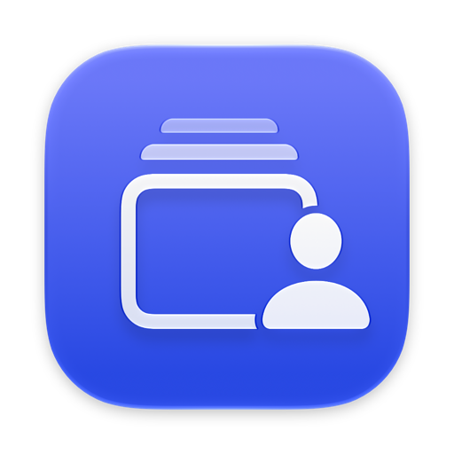
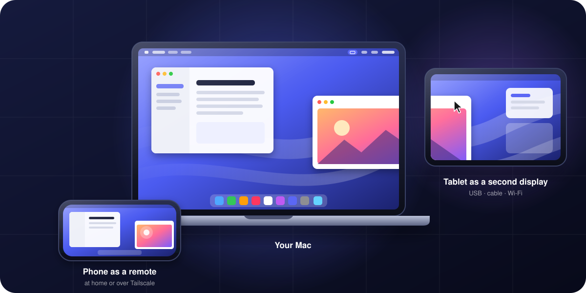

  

<h1 align="center">Universal Display</h1>

  <strong>Turn an Android tablet — or another Mac — into a second display for your Mac.</strong> 
  Smooth, sharp, plug-and-play over USB, a cable or Wi‑Fi.

  
  
  
  

  <a href="https://github.com/hertlyhq/universal-display/releases/latest/download/UniversalDisplay-mac.zip"><b>⬇︎ Download for Mac</b></a>
  &nbsp;·&nbsp;
  <a href="https://github.com/hertlyhq/universal-display/releases/latest/download/UniversalDisplay.apk"><b>⬇︎ Android app</b></a>

  

## Why Universal Display

That tablet in a drawer can be a real extra screen for your Mac — not a mirrored picture, but a true
extended display that macOS treats like any monitor. Drag windows onto it, keep a chat or a reference
open, use it as a dashboard. And when you want, control the Mac right from the tablet.

## Highlights

- **🖥️ A real second display.** macOS sees a new monitor sized for your tablet. Arrange it left, right,
  above or below — Universal Display remembers where you put it.
- **⚡️ Smooth.** Hardware video encoding on the Mac and hardware decoding on the receiver:
  ~57–60 fps with ~20–70 ms from Mac to screen. The pointer travels on its own, ahead of the picture,
  so it moves instantly.
- **🔌 USB, cable or Wi‑Fi — switch freely.** Plug the tablet in and it connects by itself. Unplug it and
  the picture moves to Wi‑Fi without your windows jumping around.
- **📐 Looks native.** Text and windows keep the same physical size as on your Mac's own screen.
- **👆 Touch and keyboard control (optional).** Tap to click, drag, scroll with two fingers, pinch to zoom,
  swipe with three fingers between desktops like on a Mac trackpad, and type with the on‑screen or a
  hardware keyboard.
- **💻 Mac to Mac.** Use a second Mac as a display with one click — or just plug in a USB‑C cable: the Mac
  that isn't set up as a display connects to the other by itself, with the lowest latency (~15 ms).
- **🔐 Private by design.** Everything stays on your local network or cable. Wi‑Fi devices pair once with a
  4‑digit code.
- **🔄 Always up to date.** The Mac app updates itself, and keeps the tablet app updated too.

## Get started

### 1. On your Mac

1. [Download `UniversalDisplay-mac.zip`](https://github.com/hertlyhq/universal-display/releases/latest/download/UniversalDisplay-mac.zip),
   unzip it and move **Universal Display** to **Applications**.
2. Open it. It lives in the menu bar.
3. Allow **Screen Recording** when macOS asks (System Settings › Privacy & Security), then reopen the app.

> [!NOTE]
> Universal Display is a personal project and isn't notarized by Apple. The first time, macOS may refuse to
> open it: go to **System Settings › Privacy & Security** and click **Open Anyway**.

### 2. On your tablet

- **Over USB (easiest):** turn on *USB debugging* on the tablet (Developer options) and plug it into the
  Mac. Universal Display installs the tablet app and starts showing your screen — no download needed.
- **Over Wi‑Fi:** install [`UniversalDisplay.apk`](https://github.com/hertlyhq/universal-display/releases/latest/download/UniversalDisplay.apk),
  open it, then press **Connect** next to the tablet in the Mac's menu and type the code shown on the
  tablet.

### 3. Optional: control the Mac from the tablet

Tap the tablet (or click on the other Mac) and press **Request control**, then **Allow** on your Mac.
Or click the cursor icon next to the device in the menu. Allow **Accessibility** when macOS asks.

| On the tablet | Does |
|---|---|
| Tap / double tap | Click / double click |
| Drag | Drag, select, move windows |
| Two‑finger drag | Scroll (with momentum) |
| Long press or two‑finger tap | Right click |
| Pinch | Zoom in / out |
| Three‑finger swipe left / right | Switch desktops (Spaces) |
| Three‑finger swipe up / down | Mission Control / App windows |
| ⌨ button | On‑screen keyboard |

## Performance

Measured on a MacBook Air (M3), a MacBook Pro (M1 Pro) and an 11" MediaTek tablet:

| Setup | Frame rate | Mac → screen |
|---|---|---|
| Mac → Mac, USB‑C cable | 55–60 fps | ~12–22 ms |
| Mac → Mac, Wi‑Fi | 55–60 fps | ~22–40 ms |
| Mac → tablet, USB | 57 fps | ~60 ms |
| Mac → tablet, Wi‑Fi | 57 fps | ~70 ms |

## Requirements

- **Mac:** macOS 14 Sonoma or later (Apple silicon).
- **Tablet:** Android 8.0 or later. USB needs *USB debugging*; Wi‑Fi needs the Mac and the tablet on the
  same network.
- **Second Mac as a display:** Universal Display on both Macs.

## Updates

- **Mac:** automatic (checks every hour; never in the middle of a session). Or use **Check for Updates…**
  in the menu.
- **Tablet:** updated by the Mac over USB. For Wi‑Fi only, add this repository to
  [Obtainium](https://github.com/ImranR98/Obtainium).

## FAQ

<b>What about iPad?</b>

Use Apple's own **Sidecar** — it's built into macOS and works great with iPad, including touch.
Universal Display is for what Sidecar can't do: Android tablets and Mac‑to‑Mac.

<b>Is the picture sent to the internet?</b>

No. The stream goes straight from your Mac to the device over USB, a cable or your local Wi‑Fi.

<b>Where is the source code?</b>

The source is private for now. This repository builds it and publishes the releases.

---

Made by <a href="https://github.com/hertlyhq">Hertly</a>. Not affiliated with Apple or Google.

